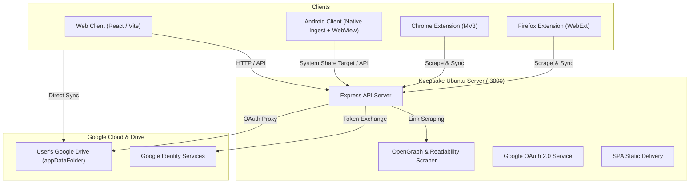

# Keepsake 📑

> **A self-hosted, Google Drive-synced Raindrop.io alternative.**  
> Complete with a web app for Ubuntu servers, an Android client with system-wide link ingestion, and browser extensions for Chrome and Firefox.

---

## ✨ Features

- **Raindrop.io-Style Visual Hierarchy & Views:**
  - 🔲 **Cards View**: Rich preview cards with cover imagery, domain favicon, excerpt, and tag chips.
  - ☰ **List View**: High information density horizontal rows for fast skimming.
  - 📄 **Headlines View**: Clean, compact text view for rapid reading.
  - 🖼️ **Moodboard View**: Pinterest-style masonry grid prioritizing photography and visual covers.
- **Deep Organization:**
  - System collections: *All Bookmarks*, *Unsorted Inbox*, *Favorites*, and *Trash*.
  - Custom collections with custom color badges, icons, and per-collection default view modes.
  - Tag management with counts, multi-tag filtering, and autocomplete.
  - Bulk actions bar: multi-select bookmarks to move, tag, favorite, or delete.
- **Omnisearch with Operator Syntax:**
  - Fast instant search across titles, URLs, snippets, notes, and tags.
  - Advanced search syntax: `#tag`, `site:domain.com`, `is:favorite`, `type:article`, `has:note`.
- **Distraction-Free Reader Mode:**
  - Extracts clean article text and media using Readability.
  - Customizable reading typography: Font size (Small, Medium, Large, XL), font family (Sans, Serif, Mono), and reading theme (Light, Sepia, Dark).
- **Google Login & Google Drive Cloud Sync:**
  - Authenticate using Google OAuth 2.0.
  - Zero lock-in: All data is saved and synced directly to the user's private Google Drive `appDataFolder` using CRDT Last-Write-Wins conflict resolution with tombstone tracking.
  - Optional visible backup exports to a `Keepsake/` Google Drive folder.
- **Cross-Platform Clients:**
  - 🌐 **Web App**: Production React SPA with instant 0ms offline-first caching and dark/light themes.
  - 🐧 **Ubuntu Server Deployable**: Ready-to-go Docker Compose and Caddy/Nginx reverse proxy setups.
  - 📱 **Android Client**: Native Android application with system Share Target (`ACTION_SEND`) to ingest links from any app (Chrome, Twitter/X, Reddit, YouTube).
  - 🧩 **Chrome Extension**: Manifest V3 extension with live card previews, tag autocomplete, notes, and context menus.
  - 🦊 **Firefox Extension**: Firefox WebExtension with full feature parity.
- **Import & Export:**
  - Netscape HTML format supported (Chrome, Safari, Firefox, Pocket, Raindrop).
  - Full JSON backup and restore.

---

## 🏛 Architecture



---

## 📂 Repository Structure

```
keepsake/
├── packages/
│   └── shared/               # Shared TypeScript models, sync algorithms, search parser, utils
├── apps/
│   ├── server/               # Node.js/Express backend (scraping, OAuth, import/export, static host)
│   ├── web/                  # Raindrop-clone React SPA (4 views, reader mode, tags, instant search)
│   ├── android/              # Native Android project with Share Target intent filter
│   └── extension/            # Cross-browser extensions (dist/chrome and dist/firefox)
├── deploy/                   # Ubuntu deployment assets (Dockerfile, docker-compose.yml, Caddyfile, systemd)
├── docs/                     # Comprehensive guides
│   ├── GOOGLE_OAUTH_SETUP.md # Google Cloud OAuth setup guide
│   ├── UBUNTU_DEPLOYMENT_GUIDE.md # Ubuntu deployment guide (Docker & systemd)
│   ├── ANDROID_SETUP_GUIDE.md # Android client installation & share sheet guide
│   └── EXTENSIONS_GUIDE.md   # Chrome and Firefox extensions installation guide
└── package.json              # Monorepo configuration
```

---

## 🚀 Quick Start (Local Development)

### Prerequisites
- Node.js 18+ (tested with Node 20 & 25)
- npm 9+

### 1. Install & Build
```bash
git clone https://github.com/your-username/keepsake.git
cd keepsake

# Build shared library
npm --workspace=@keepsake/shared run build

# Install and build web app
cd apps/web && npm install && npm run build && cd ../..

# Install and build server
cd apps/server && npm install && npm run build && cd ../..

# Build browser extensions
cd apps/extension && npm install && npm run build && cd ../..
```

### 2. Configure Environment
```bash
cp .env.example .env
nano .env
```
*(See [Google OAuth Setup Guide](docs/GOOGLE_OAUTH_SETUP.md) for details on generating credentials).*

### 3. Run Server
```bash
npm --workspace=@keepsake/server run start
```
Open [http://localhost:3000](http://localhost:3000) in your browser!

---

## 🐧 Ubuntu Server Deployment

See [Ubuntu Deployment Guide](docs/UBUNTU_DEPLOYMENT_GUIDE.md) for full instructions.

Quick Docker Compose launch:
```bash
cd deploy
docker compose up -d --build
```

---

## 📱 Android Client

See [Android Setup Guide](docs/ANDROID_SETUP_GUIDE.md).

```bash
cd apps/android
./gradlew assembleDebug
```
The APK is built at `apps/android/app/build/outputs/apk/debug/app-debug.apk`.  
Install and share any link from your phone directly to Keepsake!

---

## 🧩 Browser Extensions (Chrome & Firefox)

See [Browser Extensions Guide](docs/EXTENSIONS_GUIDE.md).

- **Chrome / Brave / Edge**: Open `chrome://extensions`, enable *Developer Mode*, and click *Load unpacked* pointing to `apps/extension/dist/chrome`.
- **Firefox**: Open `about:debugging#/runtime/this-firefox`, click *Load Temporary Add-on*, and select `apps/extension/dist/firefox/manifest.json`.

---

## 📄 License
MIT License. Created for the Keepsake project.
